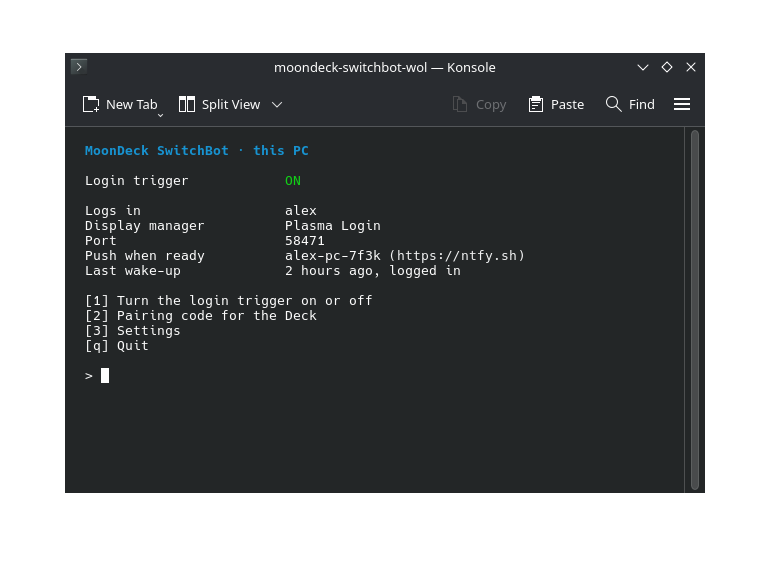
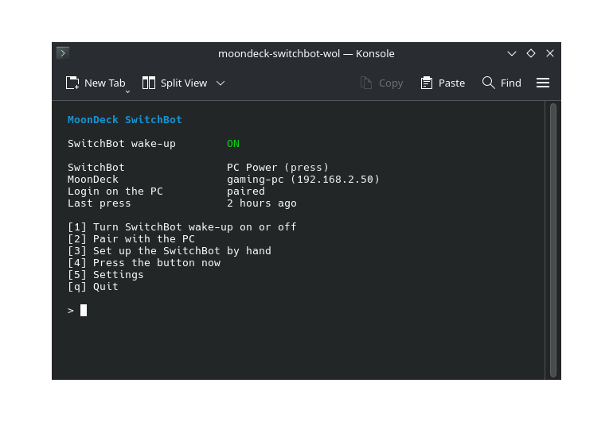
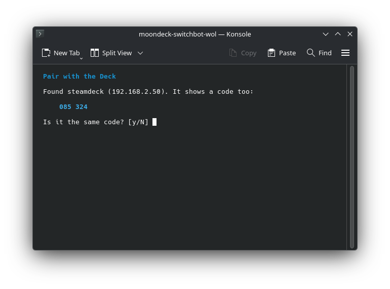
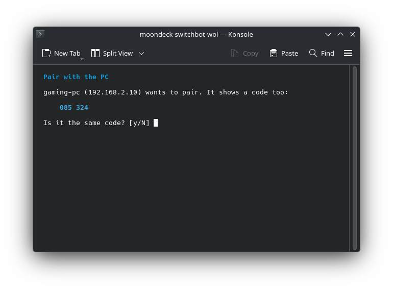

<p align="center">
  
</p>

<h1 align="center">moondeck-switchbot-wol</h1>

<h3 align="center">Wake your PC from the Steam Deck with a SwitchBot.</h3>

<p align="center">
  For <a href="https://github.com/MoonDeckTeam/moondeck">MoonDeck</a>, when Wake-on-LAN does not work. And the PC logs in on its own, but only for the Deck.
</p>

<h5 align="center">
  <a href="#install">Install</a> |
  <a href="#how-to-use">How to use</a> |
  <a href="https://github.com/Felitendo/moondeck-switchbot-wol/issues">Report a bug</a>
</h5>

<p align="center">
  <a href="https://ko-fi.com/felitendo"></a>
</p>

## Install

You need a SwitchBot Bot on the power button, and a SwitchBot hub with **Cloud Services** on for
the Bot.

<details>
<summary><b>Steam Deck</b></summary>

In Desktop Mode, open Konsole:

```bash
curl -fsSL https://raw.githubusercontent.com/Felitendo/moondeck-switchbot-wol/main/install.sh | bash
```

</details>

<details>
<summary><b>PC</b> that gets woken</summary>

```bash
git clone https://github.com/Felitendo/moondeck-switchbot-wol.git
cd moondeck-switchbot-wol
make && sudo make install
```

Optional: `msgfmt` for translations, `scdoc` for the man page.

</details>

## How to use

On the PC:

```bash
moondeck-switchbot-wol host
```

<p align="center">
  
</p>

Press **1** to turn the login trigger on, then **2** to pair with the Deck. Say yes to the
SwitchBot question, and the Deck gets everything from the PC.

On the Deck, the installer opens the menu. Later it is `~/.local/bin/moondeck-switchbot-wol`.

<p align="center">
  
</p>

Press **1** and pick **Pair with the PC**. The PC finds the Deck on its own, and both show the same
code. Press **y** on both.

<p align="center">
  
  
</p>

Then switch to Game Mode. MoonDeck wakes your PC _✨just like that✨_.

## More

<details>
<summary>How it works</summary>

| | |
|---|---|
| Wake-up | MoonDeck runs this instead of sending a magic packet. It asks the SwitchBot cloud to press the button. |
| MoonDeck | `enable` sets it up for you: this program, one wake-up only (a second press turns the PC off), and 3 minutes to boot. `disable` puts back what was there. |
| Pairing | The PC looks for the Deck on its network. The code on both comes from a key they share, so you know they found each other. What the PC sends is encrypted with it. |
| Login | The Deck proves that it woke the PC, with the secret from pairing. On a wake-up, the secret never goes over the network. The PC logs you in once. Switched on by hand, it still asks for the password. |
| Address | The Deck uses the address MoonDeck has for the PC, so a new one from your router changes nothing. |
| Push | Optional: a push through [ntfy](https://ntfy.sh) once the PC is ready to stream. |

The login works with Plasma Login and SDDM.

</details>

<details>
<summary>Commands</summary>

| | |
|---|---|
| `moondeck-switchbot-wol` | The menu on the Deck |
| `… enable` | Let MoonDeck use the SwitchBot |
| `… disable` | Give MoonDeck its Wake-on-LAN back |
| `… pair [CODE]` | Pair with the PC, or paste its code |
| `… press` | Press the button now |
| `… log` | The last wake-ups |
| `moondeck-switchbot-wol host` | The menu on the PC |
| `… host enable` | Turn the login trigger on |
| `… host disable` | Turn it off |
| `… host pair` | Find the Deck and pair with it |
| `… host code` | A pairing code, for when the PC cannot find the Deck |

</details>

<details>
<summary>Help</summary>

- **The device list is empty.** Pair the Bot with a hub and turn on **Cloud Services** for it in the
  SwitchBot app.
- **The Bot clicks, but the PC stays off.** Check that the arm reaches the button, and the battery.
- **The PC does not find the Deck.** Both have to be on the same network, and guest Wi-Fi often
  keeps devices apart. Pick **Show a pairing code instead** on the PC, and press **c** on the Deck
  to paste it.
- **MoonDeck says the wake-up failed.** `moondeck-switchbot-wol log` says why.
- **The PC stays at its login screen.** The log on the Deck says what the PC answered.
  `journalctl -u 'moondeck-switchbot-wol-login@*'` shows the PC's side.
- **A password window pops up after the login.** Your keyring is unlocked with your password, and
  nobody typed it. Remove the keyring's password, or start the app with `--password-store=basic`.

</details>

<details>
<summary>Uninstall</summary>

On the Deck:

```bash
curl -fsSL https://raw.githubusercontent.com/Felitendo/moondeck-switchbot-wol/main/install.sh | bash -s -- --uninstall
```

On the PC: `sudo moondeck-switchbot-wol host disable`, then `sudo make uninstall`.

</details>

GPL-3.0-or-later.
